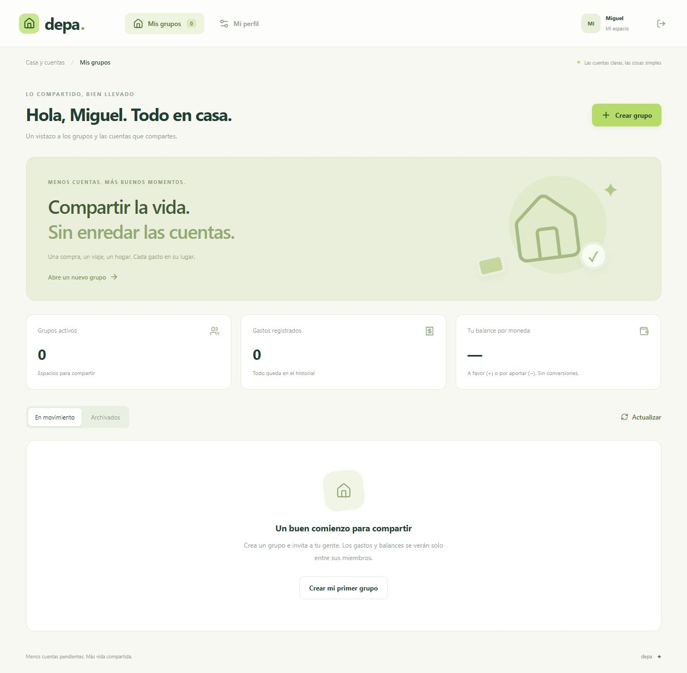

# Depa

Buena compañía. Cuentas claras.

Depa sirve para llevar los gastos de un hogar compartido, un viaje o cualquier grupo que necesite saber quién pagó y cuánto le toca a cada persona. Reparte al céntimo, calcula balances y registra pagos que confirma quien los recibe.

**Self-hosted shared expenses, exact splits, group balances and confirmed settlements.**




## Qué incluye

- Grupos privados con una moneda fija y hasta 50 miembros.
- Invitaciones por enlace; cada participante usa su propia cuenta.
- Gastos por categoría, fecha y persona que pagó.
- Reparto por igual o por importes exactos entre las personas seleccionadas.
- Balances por miembro y sugerencias de transferencias para compensarlos.
- Pagos pendientes que solo confirma quien recibe.
- Historial de actividad, edición y retirada de gastos.
- Exportación CSV y archivo de grupos en modo consulta.
- Diseño adaptable con animaciones y soporte para movimiento reducido.

La instalación empieza vacía. No hay grupos, cuentas ni gastos de demostración.

## Instalar

Necesitas **Node.js 22.13 o superior** y npm. SQLite viene incluido en Node. En Node 22 puede aparecer un aviso experimental al utilizarlo.

```sh
git clone https://github.com/MIGUEL-MOSCOSO-DEV/depa.git
cd depa
npm ci
npm run dev
```

Abre **http://localhost:3300**, crea tu cuenta y abre tu primer grupo. Guarda la invitación y compártela con las personas que deban participar.

## Producción

```sh
npm run build
npm start
```

La aplicación sirve la interfaz y la API desde una misma dirección. Para invitar a personas desde otros dispositivos, configura un dominio con HTTPS y ajusta **APP_URL**. Un enlace de localhost no sirve fuera de tu propio equipo.

Copia **.env.example** a **.env** si necesitas cambiar:

- **PORT**: puerto HTTP; por defecto, 3300.
- **HOST**: interfaz de escucha; por defecto, 127.0.0.1.
- **APP_URL**: dirección pública de Depa. Debe coincidir con la dirección usada en el navegador.
- **DATABASE_PATH**: archivo SQLite; por defecto, ./data/depa.sqlite.

Las rutas relativas se resuelven desde la carpeta del proyecto. Conserva SQLite en almacenamiento persistente. Con HTTPS, las cookies usan Secure. La aplicación no confía automáticamente en cabeceras de proxy; configura esa confianza si necesitas límites por IP detrás de un proxy inverso.

## Cómo se llevan las cuentas

Los importes se guardan como céntimos enteros. En el reparto por igual, cualquier céntimo restante se asigna siguiendo un orden estable de identificadores. El resultado siempre suma el importe original. En el reparto exacto, las partes deben sumar exactamente el gasto.

Solo participan las personas seleccionadas en cada gasto. Un miembro que llega después no modifica los repartos anteriores. La moneda de un grupo no cambia y los balances de monedas distintas se muestran separados, sin conversión.

Un saldo positivo significa que esa persona tiene dinero a favor; uno negativo indica cuánto le falta compensar. Las transferencias sugeridas emparejan saldos para reducir movimientos. No se garantiza que el algoritmo produzca el mínimo global de transferencias en todos los casos.

Registrar un pago no cambia el balance. La persona que lo recibe debe confirmarlo desde su propia cuenta. Antes de confirmar, el servidor vuelve a comprobar el saldo disponible. Un pago pendiente puede cancelarse; uno confirmado conserva su registro.

Depa **no mueve dinero ni se conecta a bancos**. Los registros de pagos se refieren a operaciones que los miembros ya realizaron por otro medio. No hay conciliación bancaria ni verificación del pago real.

## Miembros e historial

Quien crea el grupo administra sus datos, invitaciones y estado. Cada miembro puede registrar gastos y editar o retirar los que registró. La persona propietaria también puede corregir gastos del grupo. Los cambios dejan registro en la actividad.

Retirar un gasto lo excluye de los balances, pero conserva su registro en la base de datos. Los pagos confirmados no se borran al cambiar un gasto; si una corrección produce nuevos saldos, se compensan con los siguientes pagos.

Renovar o revocar una invitación no retira a quienes ya se unieron. Esta versión no incluye expulsión ni salida de miembros. Archivar el grupo mantiene el historial disponible y bloquea nuevos gastos, pagos e incorporaciones.

## Datos y copias

Para una copia completa, detén Depa y copia el archivo indicado por **DATABASE_PATH**. Conserva la copia fuera del servidor antes de reiniciar. No copies únicamente el archivo principal mientras SQLite esté escribiendo en su WAL.

El CSV exporta los gastos activos del grupo. Escapa comillas y neutraliza textos que una hoja de cálculo podría interpretar como fórmulas. No incluye todo el historial de actividad ni reemplaza una copia de SQLite. No se incluye importador CSV.

## Desarrollo

```sh
npm test
npm run check
npm run format:check
npm run build
```

- **src/** contiene grupos, gastos, balances e invitaciones en React.
- **server/** contiene Express, permisos de miembros, sesiones y SQLite.
- **shared/** contiene los repartos, balances, transferencias y escape CSV.
- **tests/** verifica céntimos, permisos, invitaciones, pagos y conservación del historial.

Las pruebas usan bases en memoria y archivos temporales aislados, sin tocar los datos de la aplicación. Las contraseñas se derivan con scrypt, las sesiones usan cookies HttpOnly y los enlaces guardan huellas de tokens. La API valida entradas con Zod y utiliza consultas parametrizadas.

El registro de cuentas está abierto. Esta versión no incluye recuperación de contraseña ni verificación de correo. Para una instalación privada, restringe el acceso desde tu red o proxy.

## Contribuir

Si encuentras un error, abre un issue con los pasos y el resultado esperado. Los cambios en repartos o balances deben conservar la suma de céntimos y venir acompañados de una prueba.

## Licencia

[MIT](LICENSE). Creado por [Miguel Moscoso](https://github.com/MIGUEL-MOSCOSO-DEV).
